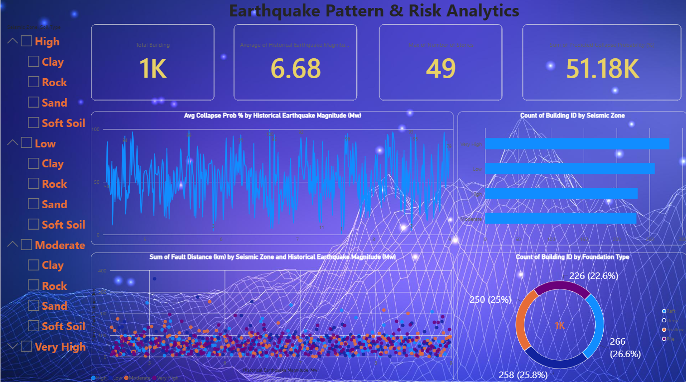

# Earthquake-Pattern-Risk-Analytics-Dashboard
1. Purpose

This dashboard analyses 1,000 buildings in earthquake-prone areas. It shows how seismic zone, soil type, earthquake magnitude and structural features relate to the predicted risk of building collapse. It helps an engineer or planner see quickly which buildings and conditions carry the most risk.

2. Data used

The dataset has 1,000 rows (one per building) and 27 columns. The columns cover:

Ground motion: PGA, PGV, PGD, spectral acceleration
Site: seismic zone, soil type, fault distance, historical earthquake magnitude
Building: height, number of stories, material, foundation type, lateral load resisting system, mass, stiffness
Predicted results: drift ratio, base shear, damage index (0–1) and collapse probability (%)

The data was cleaned before use. There were no missing values or duplicates, numbers were rounded, text was standardized, and a Building ID column was added.

3. Dashboard components

Slicers (left side). These filter the whole dashboard by Seismic Zone, Soil Type, Material, Foundation Type and Lateral Load Resisting System. When one is selected, every card and chart updates.

KPI cards (top).

Total buildings: 1,000. The number of buildings analysed.
Average magnitude: 6.68 Mw. The average historical earthquake magnitude.
Maximum magnitude: 8.99 Mw. The strongest earthquake in the data.
High-risk buildings: 502. The buildings with predicted collapse probability above 50%, which is about half of all buildings.

Zone × soil heatmap (matrix). It shows the average collapse probability for each combination of seismic zone and soil type. Darker cells mean higher risk.

Trend line chart. It shows the average collapse probability across magnitude bands (4.5–5.5, 5.5–6.5, 6.5–7.5 and 7.5–9). Since the data has no dates, magnitude bands replace a time trend.

Scatter plot. Each dot is one building, plotted by earthquake magnitude (X) against fault distance in km (Y) and coloured by seismic zone. It shows whether stronger or closer earthquakes occur together.

Bar chart: buildings by seismic zone. It shows how many buildings fall in each zone.

Donut chart: collapse risk level. Buildings are grouped as Low (0–25%), Medium (25–50%), High (50–75%) or Critical (75–100%) collapse probability.

4. Key findings
Zone distribution: Very High has the most buildings (280), followed by Low (258), High (232) and Moderate (230).
Risk levels: Low has 231 buildings, Medium 267, High 235 and Critical 267. So 502 buildings, about half, are in the High or Critical groups.
Highest-risk combination: Very High zone on Sand has the highest average collapse probability, at 58%.
Lowest-risk combination: High zone on Sand has the lowest, at 46%.
Magnitude effect: average collapse probability stays close to 50% in all four magnitude bands. It ranges from 48.5% (6.5–7.5) to 53.5% (5.5–6.5), with no steady rise as magnitude increases.
5. Conclusion

About half of the buildings in this dataset have a collapse probability above 50%, so risk is widespread. Differences between zones, soil types and magnitude bands are small, so no single factor strongly separates safe buildings from unsafe ones. The dashboard also shows that risk should be judged from several factors together, such as zone, soil, material and foundation, and not from one alone. The slicers let a user narrow the data to any group and find the highest-risk buildings.

6. Tools used

Power BI Desktop was used for the visuals, with DAX measures (COUNTROWS, AVERAGE, MAX, CALCULATE) and calculated columns for Risk Level and Magnitude Band.
